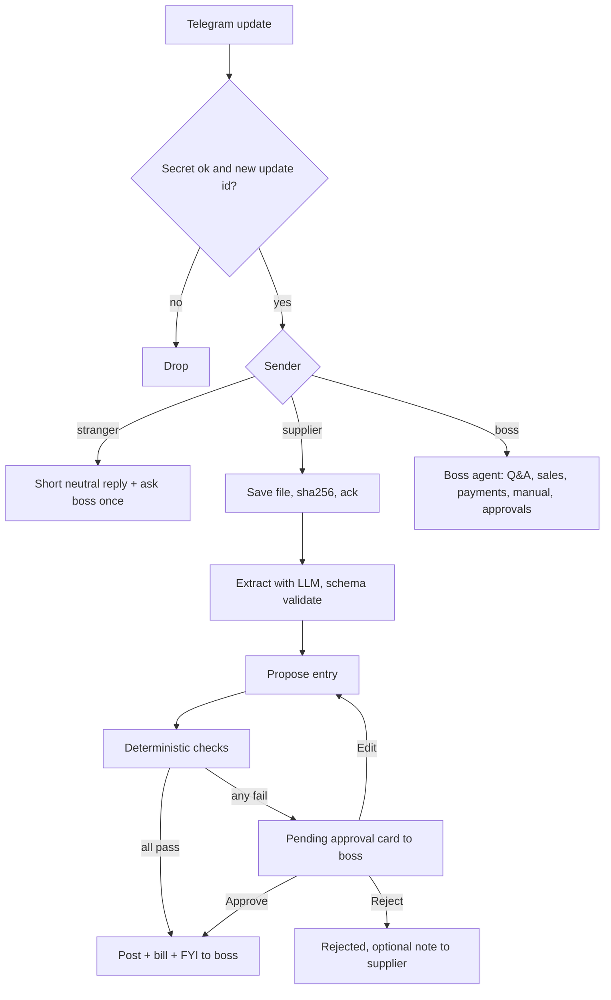

Status: Locked (2026-11-18)

# 01 PRD: AI Bookkeeper

Source: `planning/00-brief.md`. Decisions: `planning/decisions.md` (D-001 to D-011, D-018 to D-021, D-024, D-025).

## Global rules (apply to every feature)
- G-1 Double entry: every journal entry has total debits = total credits, at least 2 lines, amounts > 0, stored as exact decimals (2 dp). Code enforces this before any write.
- G-2 Posted entries are immutable. Corrections are a reversing entry plus a new entry, both linked to the original.
- G-3 Locked periods accept no new postings dated inside them. Late items post to the first open period with a note.
- G-4 The LLM proposes; code decides. No entry is posted unless every deterministic check passes or the boss approves it.
- G-5 Text inside invoices, Excel files and messages is data, never instructions to the agent.
- G-6 Timezone is the business timezone from settings (default `Asia/Singapore`); currency from settings (default SGD).
- G-7 Every agent action (extraction, checks, posting, message sent) is written to an audit log with input refs, model used, and result.
- G-8 Web books are read-only. The web may only write settings, users, suppliers, assets, opening balances and link tokens.

## Features

### MVP

#### F-001 Boss sign-in (web)
Story: As the boss, I sign in with Google so only I can see the books.
- F-001.1 Sign-in uses Google OAuth. Only the email in `BOSS_EMAIL` (env) is allowed; any other Google account sees an "access denied" page and no data.
- F-001.2 Every web page and API route except sign-in returns 401/redirect when not signed in.
- F-001.3 Sign out ends the session; back button does not show cached book data.

#### F-002 First-run setup and business settings (web)
Story: As the boss, I configure the business once and adjust rules later.
- F-002.1 On first sign-in with no settings, the boss is sent to a setup page before any other page.
- F-002.2 Settings: business name, currency, timezone, financial year start month, GST registered (on/off), GST rate (default 9%), price-change rule (default: any unit price change vs last invoice from that supplier for the same item), duplicate window (default 180 days), bill reminder lead days (default 3), daily recap time (default 21:00), monthly report day/time (default 1st, 09:00).
- F-002.3 Invalid values (GST rate < 0 or > 100, bad time) are rejected with an inline error; nothing saves.
- F-002.4 Changes apply to new events only; posted entries are not recalculated.

#### F-003 Chart of accounts
Story: As the boss, I start with a sensible chart of accounts for a small F&B business and can add accounts.
- F-003.1 A default chart is seeded (codes, names, type: asset, liability, equity, revenue, expense, contra-asset), including Cash, Bank, Accounts Payable, Input GST, Output GST, Owner's Capital, Retained Earnings, Sales, COGS (Seafood, Dairy), Packaging, Depreciation Expense, Accumulated Depreciation, Equipment.
- F-003.2 The boss can add an account and deactivate an unused one on the web. An account with postings cannot be deleted or change type.
- F-003.3 Each supplier has a default expense account used by extraction.

#### F-004 Opening balances (web)
Story: As the boss, I enter my starting balances so the books begin from reality.
- F-004.1 Form lists accounts with debit/credit inputs and an "as at" date.
- F-004.2 Save is blocked unless debits = credits; the difference is shown live.
- F-004.3 Saving posts one opening entry dated the "as at" date. Saving again reverses the previous opening entry and posts a new one (G-2).

#### F-005 Excel migration (Telegram)
Story: As the boss, I upload my existing Excel trial balance to the bot and it sets up my opening books.
- F-005.1 Boss sends an `.xlsx` to the bot; the bot reads account names and debit/credit balances from the first sheet.
- F-005.2 Each row is mapped to an existing account or flagged as "new account needed"; the bot replies with the proposed opening entry and Approve / Reject buttons.
- F-005.3 If debits != credits the bot says so with the difference and does not offer Approve.
- F-005.4 On Approve, the result is the same as F-004.3. Excel from a non-boss sender is never processed.

#### F-006 Telegram linking for the boss
Story: As the boss, I connect my Telegram account from the web in one tap.
- F-006.1 "Connect Telegram" creates a single-use token valid 24 hours and shows a `t.me/<bot>?start=<token>` link and QR code.
- F-006.2 Opening the link and pressing Start binds that Telegram user id to the boss record; the bot confirms and the web shows "Connected as @username".
- F-006.3 Expired, used or unknown tokens get a neutral reply and bind nothing.
- F-006.4 Reconnecting replaces the old Telegram id; the old id becomes a stranger.

#### F-007 Suppliers and invite links (web)
Story: As the boss, I add suppliers and send them an invite so the bot recognises them.
- F-007.1 Add supplier: name, default expense account, optional UEN, payment terms (days), optional Telegram username hint.
- F-007.2 "Create invite" makes a single-use 7-day token link; the boss copies and sends it to the supplier.
- F-007.3 Supplier opening the link binds their Telegram id to that supplier; the bot greets them briefly and tells the boss.
- F-007.4 Boss can deactivate a supplier; their later messages are treated like a stranger's.

#### F-008 Users and roles (web)
Story: As the boss, I see who can talk to the bot and in what role.
- F-008.1 Users page lists each linked Telegram account: display name, @username, role (boss or supplier), linked supplier, status, linked date.
- F-008.2 Boss can change a supplier user's linked supplier, deactivate a user, or revoke a link. There is exactly one active boss.
- F-008.3 Supplier role has no access to anything except sending documents and getting acknowledgements (enforced in the bot, not only in prompts).

#### F-009 Message intake and routing (Telegram webhook)
Story: As the system, I receive every Telegram update at one endpoint and route it by sender.
- F-009.1 Updates without the correct secret header are rejected (403) and not processed.
- F-009.2 Each update id is processed at most once (repeated delivery has no extra effect).
- F-009.3 Sender is resolved by Telegram user id to boss, active supplier, or stranger before any agent runs.
- F-009.4 The webhook responds within 2 seconds; slow work continues in the background.

#### F-010 Stranger handling
Story: As the boss, strangers don't get information, and I decide what to do with them.
- F-010.1 A stranger gets one short neutral human-style reply (e.g. "Hi, who's this?"); no business name, amounts, supplier names or bot capabilities.
- F-010.2 The boss gets a message with the stranger's name, @username, first message preview, and buttons: Ignore / Add as supplier / Block.
- F-010.3 Add as supplier lets the boss pick an existing supplier or create one by name; the stranger is then bound and told briefly they're set up.
- F-010.4 Further messages from the same stranger within 24 hours get no reply and no repeat boss ping. Ignored and blocked users get no reply ever.
- F-010.5 Documents from strangers are not extracted or posted.

#### F-011 Invoice intake and storage
Story: As a supplier, I send a PDF or photo and the bot takes it.
- F-011.1 Accepts PDF, JPG, PNG, HEIC up to 20 MB; other types get a short "please send PDF or photo" reply.
- F-011.2 File saved under the local storage folder by date and supplier; Postgres stores path, sha256, mime, size, sender, received time.
- F-011.3 Supplier receives a short acknowledgement within 10 seconds ("Got it, thanks").
- F-011.4 The same file (same sha256) received again is linked to the earlier document, not stored twice.

#### F-012 Extraction and proposed entry
Story: As the bookkeeper, I read the invoice and propose the right entry.
- F-012.1 Extracts: supplier name, invoice number, invoice date, due date (or terms), line items (description, qty, unit, unit price, line total), subtotal, GST, total, currency.
- F-012.2 Output is schema-validated; a field the model cannot read is null, not guessed. Missing invoice number or total sends it to the boss.
- F-012.3 Proposed entry: Dr supplier's expense account(s) for subtotal, Dr Input GST for GST (only when GST registered; otherwise GST included in expense), Cr Accounts Payable for total.
- F-012.4 Each proposal stores a confidence and the model name.

#### F-013 Deterministic checks
Story: As the boss, I trust the books because code checks every proposal.
Checks, each stored with pass/fail and reason:
- F-013.1 Known supplier: sender is an active supplier and the extracted supplier name matches it (fuzzy match).
- F-013.2 Arithmetic: each line qty x unit price = line total (tolerance 0.01), sum of lines = subtotal, subtotal + GST = total.
- F-013.3 GST: when registered, GST = subtotal x rate (tolerance 0.05); when not registered, no Input GST line.
- F-013.4 Balanced: entry debits = credits (G-1).
- F-013.5 Duplicate: same supplier + invoice number, or same sha256, or same supplier + date + total within the duplicate window.
- F-013.6 Revision: same supplier + invoice number but different amounts or lines = revised invoice.
- F-013.7 Price change: any line's unit price differs from that supplier's last price for the same item (item matched by normalized description), per the settings rule.
- F-013.8 Period: invoice date not in a locked period (if so, flagged and dated into first open period on approval).
- F-013.9 Sanity: date not in the future, not older than 12 months, total > 0, currency = business currency.
- F-013.10 Suspicious content: document text contains instruction-like content (code pattern scan, e.g. "ignore previous", "system:", "pre-approved", "post to", "send to @") or the extractor flags it. Either one fails the check. Added after lock, see decisions.md#D-025.

#### F-014 Auto-post and FYI
Story: As the boss, clean invoices just get done and I get a short heads-up.
- F-014.1 If every check passes, the entry posts with status `posted`, source = auto, and an AP bill with due date is created.
- F-014.2 Boss gets an FYI: supplier, invoice no., total, due date, accounts hit, in 3 lines or fewer.
- F-014.3 After posting, the trial balance still balances; if not, posting is rolled back and the boss is alerted (F-015 path).

#### F-015 Exceptions and boss approval
Story: As the boss, I'm only asked when something is off, and I can fix it with buttons.
- F-015.1 Any failed check holds the entry as `pending_approval`; the boss gets a message listing each failed check in plain words, the proposed entry, and buttons Approve / Edit / Reject.
- F-015.2 Approve posts the entry as proposed (source = boss_approved).
- F-015.3 Edit lets the boss reply with corrections in plain text (e.g. "total is 432.60", "use Packaging account"); the agent revises, checks rerun, and the boss gets a new card.
- F-015.4 Reject marks it `rejected`, nothing posts, and the bot asks whether to tell the supplier; on yes it sends the supplier a short neutral note.
- F-015.5 Duplicate: card says which earlier entry it duplicates; buttons Ignore duplicate / Post anyway.
- F-015.6 Revised invoice: card shows old vs new; Approve posts a reversal of the original and a new entry (G-2); bill is updated.
- F-015.7 Pending items older than 24 hours are included in the daily recap.
- F-015.8 Only the boss's Telegram id can press these buttons; presses from anyone else do nothing.

#### F-016 Daily sales
Story: As the boss, I send today's sales and it's booked.
- F-016.1 Boss sends a text ("sales today 1,850, cash 420, card 1,430") or a photo of the POS Z-report.
- F-016.2 Bot proposes Dr Cash / Dr Bank, Cr Sales, Cr Output GST (if registered, GST-inclusive split); boss confirms with a button before posting.
- F-016.3 A second sales entry for the same date asks whether to replace (reverse + repost) or add.
- F-016.4 If no sales were sent by the daily recap time, the recap reminds the boss.

#### F-017 Bills, payments and reminders
Story: As the boss, I know what I owe and the bot nudges me before bills are due.
- F-017.1 Each posted supplier invoice creates a bill: supplier, amount, due date (invoice due date, else invoice date + supplier terms), status open/paid.
- F-017.2 Boss marks paid by button on any bill message or by text ("paid ocean fresh inv 1043"); bot posts Dr Accounts Payable / Cr Bank on the stated date (default today) after confirm.
- F-017.3 Reminder sent N days before due (settings) and on the due date for each open bill, each reminder once.
- F-017.4 Overdue bills are listed in every daily recap until paid.
- F-017.5 Partial payment is supported; bill shows remaining balance.

#### F-018 Boss Q&A
Story: As the boss, I ask the bot about my numbers in plain language.
- F-018.1 The bot answers questions about spend, sales, bills, suppliers, balances and periods using read-only tools over the ledger.
- F-018.2 Answers state the period and give numbers that match the web reports for the same filter.
- F-018.3 If the question is ambiguous or out of scope, the bot asks one short clarifying question or says it can't help.
- F-018.4 Replies are short and conversational, like a human bookkeeper.

#### F-019 Boss manual entries
Story: As the boss, I tell the bot about a cash expense or adjustment and it records it.
- F-019.1 Boss says e.g. "paid 50 cash for ice today"; bot proposes a balanced entry and shows Confirm / Edit / Cancel.
- F-019.2 Nothing posts without Confirm. G-1 and G-3 apply.
- F-019.3 Boss can ask to reverse a specific entry; bot shows it and posts a reversal on Confirm.

#### F-020 Daily recap
Story: As the boss, I get a short end-of-day summary.
- F-020.1 Sent at the configured time: invoices logged (count, total), sales booked, pending approvals, bills due in the next N days, overdue bills, strangers seen.
- F-020.2 If nothing happened, one line saying so.
- F-020.3 Sent once per day even if the server restarts.

#### F-021 Fixed assets and depreciation (web)
Story: As the boss, I register equipment and depreciation is handled at month end.
- F-021.1 Asset form: name, purchase date, cost, salvage value, useful life (months), method (straight-line), asset account.
- F-021.2 Monthly depreciation = (cost - salvage) / life, stops at salvage value, starts the month after purchase.
- F-021.3 Asset list shows cost, accumulated depreciation, net book value.

#### F-022 Month-end close
Story: As the boss, the bot prepares the close and I approve it once.
- F-022.1 On day 1 of a month the bot prepares the previous month: depreciation entries (adjusting), check list (TB balances, no pending approvals, sales sent for every day or flagged).
- F-022.2 Boss gets a summary with Approve close / Review on web. Blocking issues (unbalanced TB, pending approvals) are listed and Approve is not offered.
- F-022.3 On approve, adjusting entries post, the period locks (G-3), and the monthly report (F-023) is sent.
- F-022.4 A locked period cannot be unlocked in MVP.

#### F-023 Monthly report pack
Story: As the boss, I get my month's statements as a PDF in Telegram.
- F-023.1 PDF contains: trial balance, adjusted trial balance, P&L, balance sheet, cash flow statement (indirect method), AP aging, for the closed month with prior month comparison.
- F-023.2 Message includes 3 to 5 headline numbers (revenue, gross margin %, net profit, cash, payables) and a link to the web.
- F-023.3 Numbers in the PDF equal the web for the same period.

#### F-024 Accounting page: Journal tab (web)
Story: As the boss, I see every journal entry to verify the bot's work.
- F-024.1 Table: date, entry no., description, account, debit, credit, source (auto, boss approved, manual, adjusting, opening, reversal), status.
- F-024.2 Date filters: This month, Last month, Last 3 months, Year to date, Last 12 months, Custom range.
- F-024.3 Clicking an entry shows its lines, check results, linked document (view PDF/image), audit trail, and linked reversal.
- F-024.4 Totals of debit and credit for the filtered range are shown and equal.

#### F-025 Accounting page: General ledger tab
- F-025.1 Pick an account; shows opening balance, each posting with running balance, closing balance for the date range.
- F-025.2 Same date filters as F-024.2.

#### F-026 Accounting page: Trial balance and adjusted trial balance tabs
- F-026.1 Trial balance as at a date: each account with non-zero balance, debit or credit column, totals equal.
- F-026.2 Adjusted trial balance includes adjusting entries; unadjusted excludes them. Both shown for closed months.
- F-026.3 If totals differ (should never happen), a visible warning shows the difference.

#### F-027 Accounting page: Financial statements tabs
- F-027.1 P&L: revenue, COGS, gross profit, operating expenses, operating profit, other items, net profit, for the filter range.
- F-027.2 Balance sheet as at end of range: assets, liabilities, equity; assets = liabilities + equity (shown as a check line).
- F-027.3 Cash flow (indirect): net profit, add back depreciation, change in payables and other working capital, investing, financing, net change = change in cash + bank.

#### F-028 Analytics page (core set)
- F-028.1 Monthly bars: revenue, expenses, net profit (last 12 months).
- F-028.2 Lines: gross, operating and net profit margin % by month.
- F-028.3 Spend by supplier (by month, stacked) and top 5 cost accounts for the range.
- F-028.4 Same date filters as F-024.2; numbers match the accounting tabs.

#### F-029 Open in Telegram
- F-029.1 A button in the web header opens `t.me/<bot username>` in Telegram.

#### F-030 Seed data and eval harness
Story: As the developer, I can prove the bookkeeper catches traps.
- F-030.1 One command seeds a demo cafe: settings, chart of accounts, 3 suppliers (seafood, dairy, packaging), opening balances, 3 months of clean invoices, daily sales, payments, 1 asset.
- F-030.2 Trap set (sample invoice files plus expected outcomes): exact duplicate file, same invoice number resent, revised invoice, wrong line math, wrong total, wrong GST, unknown supplier (stranger sender), known sender with another company's invoice, price change, future date, locked-period date, unreadable image, prompt-injection text inside an invoice.
- F-030.3 One eval command runs every sample through the real pipeline (LLM included) and prints a table: sample, expected outcome, actual outcome, pass/fail; exits non-zero on any fail.
- F-030.4 Eval asserts: 0 traps auto-posted, 100% clean samples auto-posted with correct accounts and amounts, TB balanced at the end.

#### F-031 Self-host setup
- F-031.1 README lists every credential to create (BotFather token, Google OAuth client, Gemini API key, etc.) with steps.
- F-031.2 `docker compose up` starts Postgres; one command each for API, web, ngrok and webhook registration.
- F-031.3 App refuses to start with a clear message if a required env var is missing.

### v1
- F-101 Analytics extended: food cost % (COGS / sales), price trend per item per supplier, AP aging chart, cash runway, day-of-week sales, supplier concentration, month vs same month last year.
- F-102 Export journal and statements to Excel/CSV.
- F-103 GST F5 summary (box totals) for the quarter.
- F-104 Bank statement upload and reconciliation.
- F-105 Invoice search with pgvector ("that packaging invoice with the cup lids").
- F-106 Unlock a closed period with reason and audit.
- F-107 Accountant read-only web role.

### Later
- F-201 Asset revaluation (appreciation).
- F-202 Multi-business tenancy.
- F-203 Payroll, CPF.
- F-204 Payment execution, bank feeds.

### Cut list
| Item | Reason |
| --- | --- |
| Supplier web portal | Suppliers only need Telegram |
| Editing posted entries | Breaks audit trail; reversals instead (G-2) |
| Multiple bosses | One boss in MVP; accountant role in v1 |
| Non-SGD multi-currency | Single currency per deployment |
| Web-based book editing | Web is for verification; changes go through the bot |

## Non-functional
| Area | Requirement |
| --- | --- |
| Security | Google OAuth allowlist (`BOSS_EMAIL`); Telegram webhook secret header; single-use expiring link tokens; uploaded files served only to signed-in boss; secrets only in `.env`; no SQL generated by the LLM |
| Permissions | Role checked in code before every agent tool call; supplier/stranger graphs have no read access to ledger tools |
| Prompt injection | Document and message text passed as data; agent tools cannot send to arbitrary chats; outbound messages only to boss or the sending supplier |
| Data | Money as Decimal(14,2); all timestamps UTC in DB, shown in business TZ; files never deleted by the app |
| Performance | Webhook ack < 2 s; invoice to FYI or approval card < 60 s p95; web tabs < 2 s with 10k journal lines |
| Reliability | Idempotent update handling; scheduled jobs run once per slot across restarts; failed LLM calls retried twice then go to boss as "could not read" |
| Cost | Flash-class model for routine work; heavier model only where accuracy needs it |
| Accessibility | Web meets WCAG AA contrast and keyboard navigation |

## Data model sketch
| Table | Key fields |
| --- | --- |
| business_settings | name, currency, timezone, fy_start_month, gst_registered, gst_rate, price_rule, dup_window_days, reminder_days, recap_time, report_day_time |
| users | id, telegram_user_id, username, display_name, role (boss, supplier), supplier_id, status (active, deactivated, blocked) |
| strangers | telegram_user_id, username, first_seen, last_seen, decision (pending, ignored, blocked, added) |
| link_tokens | token_hash, purpose (boss, supplier), supplier_id, expires_at, used_at |
| suppliers | id, name, uen, default_account_id, terms_days, active |
| accounts | id, code, name, type, active |
| documents | id, path, sha256, mime, size, sender_user_id, received_at, kind (invoice, sales, excel) |
| invoices | id, document_id, supplier_id, invoice_no, invoice_date, due_date, subtotal, gst, total, extraction_json, confidence, model |
| invoice_lines | invoice_id, description, normalized_item, qty, unit, unit_price, line_total |
| journal_entries | id, entry_no, date, description, source, status (proposed, pending_approval, posted, rejected), kind (normal, adjusting, opening, reversal, closing), reverses_id, invoice_id, period_id |
| journal_lines | entry_id, account_id, debit, credit, memo |
| check_results | entry_id, check_code, passed, detail |
| approvals | entry_id, telegram_message_id, decision, decided_at, note |
| bills | id, invoice_id, supplier_id, amount, due_date, paid_amount, status |
| payments | id, bill_id, entry_id, amount, paid_on |
| assets | id, name, purchase_date, cost, salvage, life_months, account_id |
| periods | id, year, month, status (open, closing, locked), closed_at |
| telegram_updates | update_id, received_at, processed_at |
| scheduled_runs | job, slot, ran_at |
| audit_log | id, at, actor (agent, boss, system), action, ref_type, ref_id, model, detail_json |
| conversations | telegram_user_id, langgraph thread/checkpoint refs |

## Key flows

### Invoice pipeline


### Telegram linking
```mermaid
sequenceDiagram
  Boss->>Web: Connect Telegram / Create supplier invite
  Web->>DB: single-use token (hash, expiry)
  Web-->>Boss: t.me/bot?start=token
  Boss or Supplier->>Bot: /start token
  Bot->>DB: verify unused, unexpired; bind telegram_user_id
  Bot-->>Boss or Supplier: short confirmation
```

## Out of scope
Everything under v1, Later and Cut list. Tax filing, statutory audit, XBRL.
